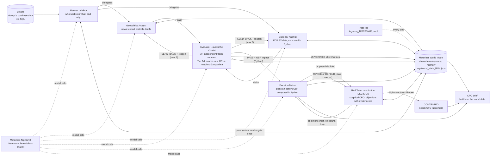

# Vidhur

**The Agent That Can Explain Why** - Open Agent Hackathon 2026 (GenAI Works), Track 2.

## What it is

Vidhur is an **auditor's agent for cost risk**. For a fictional UK AI-server maker, **Ganga AI Solutions**, it looks at what the company buys, asks
specialist analysts what could push those costs up (export controls, tariffs, currency moves), and then **checks every claim before it counts**:
against trusted, independent, fresh sources (ranked by publisher) and against the company's own purchase data (read from Zetaris with SQL).
Claims that cannot be verified get no number. The claims that survive become a **decision** (hedge, lock the price, add a second supplier, or do
nothing) and a **Red Team** challenges that decision, like a sceptical CFO, **before it reaches the CFO brief**. Every GBP figure is computed in
plain Python, every step is traced, and the brief says which evidence supports each number.

## Architecture

The loop, in one picture:

```text
                       Zetaris  (Ganga's purchase data, SQL)
                           |
                       Planner  --- decides who works on what, and why
                           |
              +------------+-------------+
              v                          v
     Geopolitics Analyst          Currency Analyst        (run in parallel)
              |   claim                  |   claim
              +------------+-------------+
                           v
                      Evaluator  --- audits the CLAIM: 2+ independent fresh sources, trusted tier,
                       |    |        real URLs, matches Ganga data
          SEND_BACK +  |    | PASS + GBP impact (Python)
          reason (max 2)    v
       back to analyst   Decision Maker  <------------->  Red Team   --- audits the DECISION
                           |             objections /      (max 2 rounds; a high objection left
                           |             revise or defend   standing = CONTESTED)
                           v
                      CFO brief

   World State (Meterless World Model) = the shared memory every agent writes to and reads from; the brief is built from it.
   Nightshift + NVIDIA Nemotron = the only AI. Trace log = every step, model, latency.
```

The same loop with more detail:



What happens in a run (`python main.py`):

1. **Zetaris health check**, then Ganga's spend by part and supplier country (SQL on Zetaris, not the CSV files).
2. **Planner (Vidhur)** reads that spend plus a quick headline scan and decides *which analysts run for which parts and why* (a real
   model call; the plan is validated in Python and may skip analyst/part pairs, e.g. no FX data exists for the Taiwan dollar).
3. **Analysts run in parallel** (3 workers). The Geopolitics Analyst turns the 8 most relevant news articles into a claim; the
   Currency Analyst computes the real 30/90-day move of the supplier's currency against the pound from ECB data in Python and the model only explains it.
4. **Evaluator** reads each claim from the world state: deterministic checks first (2+ sources, different publishers, fresh, every URL really
   fetched, part and country exist in Zetaris, FX numbers match the computed ones), then a Nemotron "do the sources support the claim?" check.
   Then the trust rules: at least one fresh Tier 1 or Tier 2 source, copies of one report count once, stale sources do not count.
   `SEND_BACK` returns the claim to the analyst with the reason (max 2 retries), then `UNVERIFIED`.
5. **Planner reviews** the world state and may **re-delegate once** (e.g. ask the other analyst about a high-spend part that ended unverified).
6. **GBP impact** is plain Python from Zetaris data (latest-quarter spend x % range); confidence comes from the Evaluator result.
7. **Decision Maker** proposes one decision per verified claim (no action / hedge a share / lock the price / second supplier) and the **Red Team**
   challenges it (next section). The brief's *Recommended decisions* section compares the options in GBP.
8. **CFO brief** (`output_examples/brief_<timestamp>.md`) is built from the world state: plan and reasons, verified claims with worst/likely/best GBP,
   UNVERIFIED items, evidence trail, and pointers to the trace and the world-state file.


## Sponsor technology

- **Zetaris - the data layer.** Ganga's data lives in Zetaris, not in the CSV files. `scripts/load_ganga_to_zetaris.py` copies `data/*.csv` into the
  Zetaris volume and registers three Lightning filestore tables in a `ganga` database: `ganga.parts`, `ganga.suppliers`, `ganga.purchases`.
  The agents read them with SQL through `core/zetaris_client.py` (REST, one statement per request): the latest quarter (`SELECT MAX(quarter) FROM ganga.purchases`),
  spend per part and supplier country (`ganga.purchases` joined to `ganga.parts` and `ganga.suppliers`), a part-to-country catalogue the Evaluator
  checks claims against, and per-part quarterly spend for the GBP impact. Every query is logged in the trace (`zetaris:sql`).
- **Meterless - the World Model engine.** The shared memory is the Meterless World Model, implemented in Python from the official spec in `engines/world_model/`
  (event-sourced append-only log, content-derived stable ids, provenance on every write, bitemporal edges, idempotent ingest, audit log). Agents never
  pass data to each other directly: they write to and read from this World State, saved per run as `logs/world_state_<run_id>.json`.
  **Conformance test path:** `tests/test_world_model_engine.py` is the spec's 8 conformance checks (`sid-001 sid-002 band-001 prov-001 idem-001 idem-002
  bitemp-001 audit-001`) ported 1:1 to Python, plus golden-data tests against the TypeScript reference (`tests/data/world_model_golden.json`).
  Run `python -m pytest tests/test_world_model_engine.py`. Details and the two documented differences from the reference: [`docs/meterless_engine.md`](docs/meterless_engine.md).
- **Meterless Nightshift - the only AI provider.** Every model call goes through `core/llm.py` to the Nightshift OpenAI-compatible endpoint. There is no other AI provider in the code.
- **NVIDIA Nemotron - the model.** Nightshift lanes resolve to Nemotron. Every AI call line in the trace records `requested_lane`, `answered_model` and `pin_honoured`,
  so the evidence of which Nemotron model actually answered is in the trace files (`logs/run_*.jsonl`). `python scripts/check_lanes.py` re-tests the lanes.
- **Built with Claude Code.** The organisers made Cursor optional, so this was built with Claude Code.

## Setup

Prerequisites: Docker Desktop with the **Zetaris** platform running (UI http://localhost:3000, API http://localhost:8888) and the **Meterless Nightshift**
app running (http://127.0.0.1:8088/v1) with a lane called `vidhur-analyst`.

Start Zetaris if it is not running: in the folder that holds Zetaris's `docker-compose.yml` (on the build machine, `~/zetaris-platform` inside WSL) run

```bash
docker compose up -d
```

### Local (Windows PowerShell)

```powershell
python -m venv venv
venv\Scripts\activate
pip install -r requirements.txt
copy .env.example .env                     # fill in the Nightshift token and the Zetaris login - never commit .env
python scripts/load_ganga_to_zetaris.py    # once: copies data/*.csv into Zetaris and registers the tables (safe to run twice)
python scripts/healthcheck.py              # ALWAYS run this first
python main.py
```

### Docker

```powershell
docker build -t vidhur .
docker run --rm --env-file .env vidhur python scripts/healthcheck.py
docker run --rm --env-file .env -v "${PWD}/output_examples:/app/output_examples" -v "${PWD}/input_examples:/app/input_examples" -v "${PWD}/logs:/app/logs" vidhur
```

Inside a container `localhost` is the container itself, so Vidhur reaches Nightshift and Zetaris at **`host.docker.internal`**. This is automatic:
the image sets `VIDHUR_IN_DOCKER=1` and `core/config.py` rewrites `localhost` / `127.0.0.1` in `METERLESS_BASE_URL` and `ZETARIS_API_URL` to
`host.docker.internal` (override the name with `DOCKER_HOST_ALIAS`). The same `.env` works locally and in Docker; `.env` is never copied into the image
(`.dockerignore`), so pass it with `--env-file`.

### The healthcheck (and what `main.py` does first)

`python scripts/healthcheck.py` finishes in under 30 s and prints a PASS / FAIL list: required environment variables are set (names only, values are never printed);
**Nightshift** is reachable and the token is valid (one tiny call, it shows which model answered); **Zetaris** is reachable and the `ganga` tables are present.
`main.py` runs the same checks before it starts and stops with a clear message if one fails (`--skip-healthcheck` to bypass).

### If a service is down

- **Zetaris not reachable:** the message tells you to start it (the `docker compose up -d` command above) and the program exits without a traceback.
- **Nightshift busy or offline** (502s, timeouts, connection refused after the automatic retries): Vidhur does not crash. Whatever completed is saved to the World State and the
  trace, the brief lists the agents that could not run and why, the console prints `AI runtime busy or offline — partial results saved. Try again later.`
  and the exit code is non-zero (`1` = stopped before the run by the healthcheck, `2` = partial results saved).
- A decision whose Red Team call failed is labelled **"Red Team review could not run — AI runtime busy. Treat this recommendation as unreviewed."**
  A decision the Red Team did review and raised no high or medium objection to says so, in different words.

## Usage

```powershell
python main.py                            # the full run (15-20 minutes)
python main.py --demo-weak-claim          # watch the Evaluator catch a weak claim (below)
python main.py --demo-untrusted-source    # watch it catch a claim backed only by untrusted sources (below)
python main.py --demo-red-team            # watch the Red Team challenge an aggressive decision (below)
python main.py --workers 2                # analysts in parallel (default 3)
python main.py --refresh-news             # ignore the news cache and fetch live
python main.py --skip-healthcheck         # skip the start-up checks
python scripts/healthcheck.py             # PASS / FAIL list for Nightshift, Zetaris, env vars
python scripts/check_lanes.py             # which Nemotron model answers each Nightshift lane (3 calls per lane)
python -m pytest tests                    # all tests; integration tests skip if Zetaris / Nightshift are down
```

Env (see `.env.example`): `PLANNER_MAX_DELEGATIONS` (default 4), `LLM_MAX_ATTEMPTS` (default 5), `EVIDENCE_MAX_AGE_DAYS` (default 30).
Decision premiums: `data/decision_assumptions.csv`.

### `--demo-weak-claim` (a demo flag, not hidden faking)

With this flag the **Geopolitics Analyst's first attempt** gets one extra instruction: cite exactly one source. The model call is real and
the Evaluator's check is real; only the analyst's instruction changes. The Evaluator then sends the claim back (`TOO_FEW_SOURCES`), the analyst
revises it with the feedback, and the brief shows the full audit history. The flag is printed in the console, recorded in the trace
(`demo_weak_claim: true`) and stated at the top of the brief. (The Currency Analyst always cites the FX data plus news, so the flag does not affect it.)

### `--demo-red-team` (a demo flag, not hidden faking)

With this flag the **first proposal for the lowest-confidence verified claim** gets one extra instruction: hedge 100% of that part's spend.
The Decision Maker, the Red Team and the loop are real model calls with real validation; the Red Team decides what to object to, and the Decision
Maker decides whether to revise or defend. The run ends with the decision revised, defended or `CONTESTED`. The flag is printed, recorded in the trace
(`demo_aggressive: true`) and stated at the top of the brief.

### `--demo-untrusted-source` (a demo flag, not hidden faking)

With this flag the **Geopolitics Analyst's first attempt** is shown the *least-trusted* articles first (Tier 3 before Tier 1) and is told to
cite only the first two. The model call and the Evaluator's check are real; only the evidence offered to the analyst and the instruction change.
The Evaluator sends the claim back (`NO_TRUSTED_SOURCE`, and `SOURCES_NOT_INDEPENDENT` if the two share a publisher), the analyst revises
from the normal trust-ranked evidence, and the claim passes on retry or ends `UNVERIFIED`. The flag is printed, recorded in the trace
(`demo_untrusted_source: true`) and stated at the top of the brief.


## Data

**Ganga AI Solutions is fictional and its data is synthetic**, prepared before the build window. Everything in `data/` (parts, suppliers, quarterly prices
and quantities) is made up; see `data/README_DATA.md`. The **evidence is real**: news from free RSS feeds (Google News search plus BBC, The Guardian,
Al Jazeera, NPR, DW) and exchange rates from the free ECB-based Frankfurter API.

`data/decision_assumptions.csv` (`option,premium_pct,note`) holds the premiums the Decision Maker uses for a hedge (1.5%), a price lock (2%) and a second
supplier (3%). They are **illustrative assumptions, not market quotes**, and the CFO brief points to the file under every option comparison.


## Sample inputs and outputs

`input_examples/input_<time>.json` is saved by `main.py` for each run (the command, flags, lanes and Ganga spend read from Zetaris, no secrets);
`output_examples/brief_<time>.md` is the CFO brief it produced; the trace is `logs/run_<time>.jsonl`. These are real runs; outputs are never edited by hand.

| Input | Output (brief) | What it shows |
|---|---|---|
| `input_20261023_074501.json` (`python main.py`) | `brief_20261023_075606.md` | A normal run, before the Decision Maker existed: Planner's plan, verified claims with worst / likely / best GBP, evidence trail with publisher tiers |
| `input_20261023_081111.json` (`--demo-untrusted-source`) | `brief_20261023_081832.md` | The Evaluator rejecting a first attempt that cited only untrusted sources (`NO_TRUSTED_SOURCE`) and the analyst revising |
| `input_20261023_150615.json` (`python main.py`) | `brief_20261023_152556.md` | A normal run with the Decision Maker and Red Team stage; the runtime was returning 502s, so one analyst item is `NOT_ASSESSED`, one decision was not produced and the other is shown as not challenged |
| `input_20261023_152706.json` (`--demo-red-team`) | `brief_20261023_154540.md` | The red-team demo run: aggressive first proposals; the Red Team calls failed on the 502s, so two decisions are labelled not challenged and one was not produced |

Also in `output_examples/`, from before input files were saved: `brief_20261022_224215.md` and `brief_20261023_015139.md` are `--demo-weak-claim` runs
(the Evaluator sends back a one-source claim: `TOO_FEW_SOURCES`; traces `logs/run_20261022_222600.jsonl` and `logs/run_20261023_014729.jsonl`), and
`brief_20261022_222558.md`, `brief_20261022_232023.md`, `brief_20261023_014722.md` are earlier normal runs.
The two Red Team briefs above were produced before the "Red Team review could not run" wording was introduced, so they say "NOT challenged"; they are
unedited. A run that completes the Red Team loop has not been captured yet (see Known limitations).

## Decision Maker and Red Team (the challenge loop)

The Evaluator checks the **claims**; the **Red Team** checks the **decision** built on them, like a sceptical CFO or risk committee.

- **Decision Maker** (`agents/decision_maker.py`) reads the verified claim from the World State and Ganga's spend from Zetaris and picks one option
  with a rationale. **Every GBP figure is computed in Python** (`core/decisions.py`): cost under worst / likely / best and "if the forecast is
  wrong" (the mirror of the likely case), for no action, a 50% hedge, a price lock and a 30% second-supplier shift. The protection premiums
  are stated assumptions, not quotes.
- **Red Team** (`core/red_team.py`) returns structured JSON objections of five kinds: forecast wrong (opposite scenario), cost of acting vs not
  acting, concentration (supplier / country), weakest evidence, cheaper alternative. Each has a severity and must cite evidence ids (S1.., the
  work id, an option name) or numbers present in the evidence. Objections without a reference are dropped; if none survive, the model is re-asked once.
- **Challenge loop:** Red Team objects -> Decision Maker **REVISES** (new option or share, GBP recalculated in Python) or **DEFENDS** (needs evidence
  references) every high and medium objection -> Red Team re-judges -> one more round at most. **Maximum 2 rounds.** A high objection still standing
  afterwards marks the decision **CONTESTED - needs CFO judgement** instead of a confident recommendation.
- Objections, responses, outcomes and every decision version are written to the World State and logged to the trace
  (`objection`, `response`, `revised`, `review`, `round`, `outcome`). The brief shows, per decision, "Challenged by Red Team" with the top objections,
  how each was handled and the before / after GBP.

## Trusted-source ranking


Not every source is equal, so Vidhur ranks evidence by who published it, not only by how relevant it is.

- **The list** is `data/source_trust.csv` (`domain,publisher,tier,score`), a curated, editable config (see `data/SOURCE_TRUST_README.md`).
  Tier 1 = 1.0 (wires, top business press, central banks, statistics offices, WTO / IMF / World Bank, semiconductor trade bodies),
  Tier 2 = 0.7 (known business and trade press), Tier 3 = 0.3 (any unlisted domain, the default).
- **Mapping** (`core/source_trust.py`): URL -> (publisher, tier, score). Subdomains count as their parent (`uk.reuters.com` is `reuters.com`).
  Google News links point at `news.google.com`, so for those the publisher name decides.
- **Ranking before the AI sees anything:** `combined_score = 0.6 * relevance + 0.4 * trust_score`, relevance being the existing keyword and recency
  score normalised to 0-1. Only the top N (unchanged) go to the model, which cuts tokens. Kept and dropped articles are logged to the trace
  with their scores (`evidence:rank`).
- **Evaluator rules** (added to the existing checks, new send-back codes): `NO_TRUSTED_SOURCE` (no fresh Tier 1 or 2 source),
  `SOURCES_NOT_INDEPENDENT` (same domain root or near-identical headlines count once), `STALE_SOURCES` (sources older than `EVIDENCE_MAX_AGE_DAYS`,
  default 30, do not count), next to `TOO_FEW_SOURCES`. Max 2 retries, then UNVERIFIED, as before.
- **CFO brief:** every source shows publisher, tier and date, and each claim has an evidence-strength line such as
  "2 independent sources, 1 Tier 1".

## Where things are

| Path | What |
|---|---|
| `agents/planner.py` | Planner (Vidhur): plan, delegations with reasons, review and one re-delegation |
| `agents/geopolitics_analyst.py`, `agents/currency_analyst.py` | The two analysts |
| `agents/evaluator.py` | The Evaluator and the send-back loop |
| `agents/decision_maker.py`, `core/red_team.py`, `core/decisions.py` | Decision Maker, Red Team, and the option / GBP maths (Python) |
| `agents/workflow.py` | One work item: analyst -> Evaluator loop -> GBP impact |
| `engines/world_model/` | Meterless World Model engine |
| `core/shared_state.py` | Vidhur's use of the world model (what each agent writes and reads) |
| `scripts/healthcheck.py`, `core/preflight.py`, `core/failures.py` | Start-up checks (PASS / FAIL) and the "agents that could not run" report |
| `core/zetaris_client.py` | Zetaris REST client - one Lightning SQL statement per request |
| `core/llm.py` | Meterless Nightshift client (OpenAI-compatible), retries, pin tracking |
| `core/trace.py` | Append-only JSONL trace (agent, target, model, tokens, latency, sources, decision) |
| `core/news.py`, `core/fx.py` | Real evidence: RSS news and ECB exchange rates; trust-aware ranking |
| `core/source_trust.py`, `data/source_trust.csv` | Publisher trust tiers (curated list) |
| `scripts/check_lanes.py` | Calls each Nightshift lane 3 times and prints which model answered |
| `core/impact.py`, `core/brief.py` | GBP maths and confidence; the CFO brief |
| `scripts/load_ganga_to_zetaris.py` | Registers Ganga's CSVs as Zetaris tables |
| `docs/meterless_engine.md` | The World Model spec we followed and the test results |

## Notes on the AI runtime

All product AI calls go through Meterless Nightshift, and every AI call is Nvidia Nemotron. **All agents (Planner, both analysts, Evaluator) use the
lane `vidhur-analyst`** (`nvidia/nemotron-3.5-lightning-30b-a3b`); see Known limitations for why. `.env` holds the lane to request (`MODEL_*`) and the
Nemotron model that must answer (`MODEL_*_EXPECTED`). **Every AI call line in the trace records `requested_lane`, `answered_model` and `pin_honoured`**
(failed attempts record `answered_model: null`). `python scripts/check_lanes.py` re-tests the lanes. The runtime enforces a ~45 s per-request deadline
and answers 502 when a long reasoning call overruns it, so the client retries automatically (`LLM_MAX_ATTEMPTS`) and logs every failed attempt.

## Known limitations

- **Two analysts of six.** Commodity, logistics, trade & tariff and supplier-health analysts are not built.
- **Lightning is used for all agents.** The evaluator lane could not be pinned to a larger Nemotron in Nightshift: `scripts/check_lanes.py` showed `vidhur-evaluator`
  answered by Lightning (`nemotron-3.5-lightning-30b-a3b`) in 3 of 3 calls, so the Planner and Evaluator are pointed at the `vidhur-analyst` lane on purpose
  (the pin is real, not accidental). If a larger lane is fixed, set `MODEL_EVALUATOR` / `MODEL_EVALUATOR_EXPECTED` in `.env`.
- **Runtime 502s can stop the Red Team.** On 2026-10-23 the Nightshift provider answered 502 (`provider_error` / `empty_response`) to many attempts. In the captured
  runs every Red Team call failed after 8 attempts, so those decisions are labelled as not challenged (never passed off as challenged), and the Red Team loop has
  not completed in a captured live run. The loop, validation, revise / defend handling, the 2-round limit and CONTESTED escalation are covered by tests with scripted model
  replies (`tests/test_red_team.py`); the graceful-failure paths are covered by `tests/test_failure_paths.py`. Rerun `python main.py --demo-red-team` when the runtime is healthy.
- **Runs take 15-20 minutes** (many sequential model calls with retries against a per-request deadline of about 45 s on the runtime).
- **Decision premiums are assumptions** (`data/decision_assumptions.csv`), not market quotes, and the second supplier is assumed to be unexposed to the claim's driver.
  Decisions are made per claim, so two claims on one part are not combined.
- **The start-up healthcheck refuses to start while Nightshift is answering 5xx.** Use `--skip-healthcheck` to run anyway; Vidhur then retries inside the run and finishes with partial results if the runtime stays down.

## Credits

- Zetaris (data layer), Meterless (World Model spec, Nightshift runtime) and NVIDIA (Nemotron) technology as described above.
- Built for the Open Agent Hackathon 2026 with Claude Code.
