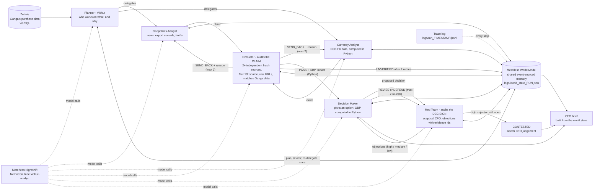

# Vidhur

**LLMs hallucinate numbers. Vidhur forces every agent claim through a deterministic audit checklist and an adversarial Red Team before a CFO sees a single pound sign.**

Vidhur turns scattered market events and company spend into a CFO-ready, evidence-backed cost decision, with every number traceable and every recommendation challenged.

**Built by a commercial auditor. Vidhur applies professional scepticism: no number without evidence, no action without challenge.**

*Open Agent Hackathon 2026 (GenAI Works), Track 2 - "The Agent That Can Explain Why".*

**Professional scepticism.** The **Evaluator** and the **Red Team** are Vidhur's *professional scepticism* layer: the auditor's way of never accepting a
claim, or a recommendation, without evidence. The Evaluator will not let a claim reach the CFO unless independent, fresh, trusted sources support it and it matches
Ganga's own data; the Red Team then attacks the resulting decision before the CFO sees it. The Evaluator checks every number in a claim against the cited
excerpt, the real FX rate and the calculator; the Red Team rejects any revision that does not give a written reason tied to evidence or a calculation.
How well that works is measured, not asserted: see **Evaluation** below.

## Before and after

| | |
|---|---|
| **Before** | An analyst manually checks the news, FX rates and supplier exposure, builds a spreadsheet, and spends hours defending the assumptions in it. |
| **After** | Vidhur produces a ranked cost-impact brief with citations, calculation records, Red Team objections and a recommended action in minutes. |

The honest number for "minutes": a live `--demo` run (two drivers) took **341 s to 990 s (about 6 to 16 minutes)** across the five recent runs, and the two kept complete runs took 738 s and 905 s. A full run is 15-20 minutes on a healthy runtime and longer when the runtime is busy. That time buys verification (parallel analysts, SQL cross-checks, deterministic checks, a Red Team loop), not just text generation.

## Three proof moments

1. **A weak claim is sent back, then verified.** The Taiwan GPU claim cites one source; the Evaluator's deterministic check sends it back (`TOO_FEW_SOURCES`), the analyst revises with the feedback, and it passes with a second source. The whole audit history is in the brief. See `output_examples/demo_run_20261024_v3/`.
2. **The Red Team changes the decision, with written reasons.** The first proposal is a 100% hedge of the part's spend. The Red Team raises objections tied to evidence ids and numbers; the Decision Maker revises it to a 20% second-supplier shift, and a revision without a written reason is rejected. Same folder, and `demo_run_20261024_v2/`.
3. **Honest COULD NOT VERIFY.** In a live run the Taiwan claim was sent back for `TOO_FEW_SOURCES`, the analyst found no better evidence, and Vidhur labelled it **COULD NOT VERIFY** (no GBP figure, and explicitly not zero impact) instead of inventing a number. The other driver (EUR) was verified, challenged twice by the Red Team, and ended at no action. See [`output_examples/live_run_20261024_could_not_verify/`](output_examples/live_run_20261024_could_not_verify/README.md).

## How it works

Vidhur is an **auditor's agent for cost risk**. For a fictional UK AI-server maker, **Ganga AI Solutions**, it looks at what the company buys, asks
specialist analysts what could push those costs up (export controls, tariffs, currency moves), and then **checks every claim before it counts**:
against trusted, independent, fresh sources (ranked by publisher) and against the company's own purchase data (read from Zetaris with SQL).
Claims that cannot be verified get no number. The claims that survive become a **decision** (hedge, lock the price, add a second supplier, or do
nothing) and a **Red Team** challenges that decision, like a sceptical CFO, **before it reaches the CFO brief**. Every GBP figure is computed in
plain Python, every step is traced, and the brief says which evidence supports each number.

### Two feedback loops

- **Evaluator send-back loop.** The Evaluator audits each *claim*. A failed check returns the claim to the analyst with the reason (up to 2 send-backs); a claim that still fails is shown as Could not verify, with no GBP figure.
- **Decision Maker <-> Red Team challenge loop.** The Red Team audits each *decision*. It raises objections that must cite evidence; the Decision Maker revises (with a written reason) or defends; the Red Team re-judges (up to 2 rounds). A high objection still standing marks the decision CONTESTED for the CFO.

### Architecture

The loop, in one picture:

```text
                       Zetaris  (Ganga's purchase data, SQL)
                           |
                       Planner  --- decides who works on what, and why
                           |
              +------------+-------------+
              v                          v
     Geopolitics Analyst          Currency Analyst        (run in parallel)
              |   claim                  |   claim
              +------------+-------------+
                           v
                      Evaluator  --- audits the CLAIM: 2+ independent fresh sources, trusted tier,
                       |    |        real URLs, matches Ganga data
          SEND_BACK +  |    | PASS + GBP impact (Python)
          reason (max 2)    v
       back to analyst   Decision Maker  <------------->  Red Team   --- audits the DECISION
                           |             objections /      (max 2 rounds; a high objection left
                           |             revise or defend   standing = CONTESTED)
                           v
                      CFO brief

   World State (Meterless World Model) = the shared memory every agent writes to and reads from; the brief is built from it.
   Nightshift + NVIDIA Nemotron = the only AI. Trace log = every step, model, latency.
```

The same loop with more detail:



What happens in a run (`python main.py`):

1. **Zetaris health check**, then Ganga's spend by part and supplier country (SQL on Zetaris, not the CSV files).
2. **Planner (Vidhur)** reads that spend plus a quick headline scan and decides *which analysts run for which parts and why* (a real
   model call; the plan is validated in Python and may skip analyst/part pairs, e.g. no FX data exists for the Taiwan dollar).
3. **Analysts run in parallel** (3 workers). The Geopolitics Analyst turns the 8 most relevant news articles into a claim; the
   Currency Analyst computes the real 30/90-day move of the supplier's currency against the pound from ECB data in Python and the model only explains it.
4. **Evaluator** reads each claim from the world state: deterministic checks first (2+ sources, different publishers, fresh, every URL really
   fetched, part and country exist in Zetaris, FX numbers match the computed ones), then a Nemotron "do the sources support the claim?" check.
   Then the trust rules: at least one fresh Tier 1 or Tier 2 source, copies of one report count once, stale sources do not count.
   `SEND_BACK` returns the claim to the analyst with the reason (max 2 retries), then `UNVERIFIED`.
5. **Planner reviews** the world state and may **re-delegate once** (e.g. ask the other analyst about a high-spend part that ended unverified).
6. **GBP impact** is plain Python from Zetaris data (latest-quarter spend x % range); confidence comes from the Evaluator result.
7. **Decision Maker** proposes one decision per verified claim (no action / hedge a share / lock the price / second supplier) and the **Red Team**
   challenges it (next section). The brief's *Recommended decisions* section compares the options in GBP.
8. **CFO brief** (`output_examples/brief_<timestamp>.md`) is built from the world state: plan and reasons, verified claims with worst/likely/best GBP,
   UNVERIFIED items, evidence trail, and pointers to the trace and the world-state file.

### Sponsor technology

- **Zetaris - the data layer.** Ganga's data lives in Zetaris, not in the CSV files. `scripts/load_ganga_to_zetaris.py` copies `data/*.csv` into the
  Zetaris volume and registers three Lightning filestore tables in a `ganga` database: `ganga.parts`, `ganga.suppliers`, `ganga.purchases`.
  The agents read them with SQL through `core/zetaris_client.py` (REST, one statement per request): the latest quarter (`SELECT MAX(quarter) FROM ganga.purchases`),
  spend per part and supplier country (`ganga.purchases` joined to `ganga.parts` and `ganga.suppliers`), a part-to-country catalogue the Evaluator
  checks claims against, and per-part quarterly spend for the GBP impact. Every query is logged in the trace (`zetaris:sql`).
- **Meterless - the World Model engine.** The shared memory is the Meterless World Model, implemented in Python from the official spec in `engines/world_model/`
  (event-sourced append-only log, content-derived stable ids, provenance on every write, bitemporal edges, idempotent ingest, audit log). Agents never
  pass data to each other directly: they write to and read from this World State, saved per run as `logs/world_state_<run_id>.json`.
  **Conformance test path:** `tests/test_world_model_engine.py` is the spec's 8 conformance checks (`sid-001 sid-002 band-001 prov-001 idem-001 idem-002
  bitemp-001 audit-001`) ported 1:1 to Python, plus golden-data tests against the TypeScript reference (`tests/data/world_model_golden.json`).
  Run `python -m pytest tests/test_world_model_engine.py`. Details and the two documented differences from the reference: [`docs/meterless_engine.md`](docs/meterless_engine.md).
- **Meterless Nightshift - the only AI provider.** Every model call goes through `core/llm.py` to the Nightshift OpenAI-compatible endpoint. There is no other AI provider in the code.
- **NVIDIA Nemotron - the model.** Nightshift lanes resolve to Nemotron. Every AI call line in the trace records `requested_lane`, `answered_model` and `pin_honoured`,
  so the evidence of which Nemotron model actually answered is in the trace files (`logs/run_*.jsonl`). `python scripts/check_lanes.py` re-tests the lanes.
- **Built with Claude Code.** The organisers made Cursor optional, so this was built with Claude Code.

### Numbers are calculated in Python, never by the AI

The model never produces a GBP figure. The analysts output only a **driver**, a **direction** (cost up / down), **evidence** (url, publisher, date and an excerpt taken from
the fetched article, not from the model) and, **only if a cited source prints one**, a percentage. `core/calculator.py` then computes the GBP impact deterministically from
Ganga's Zetaris purchase rows (part, supplier country, quantity, unit price, currency), a real ECB FX rate **with its date**, and the explicit assumptions in
`data/decision_assumptions.csv`:

```
baseline_gbp = sum(quantity x unit_price / units_of_currency_per_GBP)
change_gbp   = baseline_gbp x move% x pass_through%      (+ cost up, - saving)
```

Every figure in the CFO brief carries a **calculation record** (input rows, FX rate and date, formula, assumptions) and one label:

| Label | Meaning | Example |
|---|---|---|
| **OBSERVED** | read from data | Zetaris quantity and price, the ECB rate, the baseline spend |
| **FORECAST** | stated by a cited source | a percentage an article prints (the Evaluator checks it is in the excerpt) |
| **SCENARIO** | our assumption | the 2% / 6% / 12% move, the FX pass-through, the hedge premium |

When no source states a percentage the move comes from the SCENARIO rows of `data/decision_assumptions.csv`. Worst / likely / best is called a **scenario range, not a
probability**. The brief opens with one line, from the calculator, on why this matters (what a wrong 50% hedge would cost in GBP) and has a **"How this number was
calculated"** section for every driver. If the live FX call fails the rate stored on the Zetaris row is used and the record says so.

The Evaluator's deterministic checks (no AI, run before the model check) enforce this; a failed check uses the normal send-back loop (max 2 retries, then UNVERIFIED):

| Code | Fails when |
|---|---|
| `NUMBER_NOT_IN_SOURCE` | a % or figure in the claim is not in a cited excerpt and is not tagged `(SCENARIO)` (a range labelled FORECAST must be printed by a source) |
| `FX_MISMATCH` | a claimed FX rate differs from the real ECB rate for its date by more than 2%, the claimed move does not follow from its own rates, or the rate cannot be checked |
| `DIRECTION_MISMATCH` | the claim's direction differs from the one Python derives from the ECB data: 1 GBP buys fewer units of the currency means the part costs more in pounds (`cost_up`), more units means `cost_down` |
| `CURRENCY_COUNTRY_MISMATCH` | the currency is neither the supplier country's (Taiwan: TWD, USD as proxy; Korea: KRW; Germany: EUR; China: CNY; also Japan JPY, Malaysia MYR) nor the currency Zetaris prices the part in |
| `FX_PAIR_MISMATCH` | the FX pair of a currency claim differs from the currency of the Zetaris purchase row the GBP calculation used (for example a GBP/EUR claim on a part priced in USD) |
| `GBP_MISMATCH` | a GBP figure in the claim is more than 10% away from every calculator result for that part (or there is no calculator result to check it) |
| `DUPLICATE_SOURCE` | sources with the same outlet, the same original outlet ("via X"), the same headline or a near-identical excerpt count as one and fewer than two independent sources remain |
| `STALE_SOURCE` | a source is older than `EVIDENCE_MAX_AGE_DAYS` (config, default 30) |

### Decision Maker and Red Team (the challenge loop)

The Evaluator checks the **claims**; the **Red Team** checks the **decision** built on them, like a sceptical CFO or risk committee.

- **Decision Maker** (`agents/decision_maker.py`) reads the verified claim from the World State and Ganga's spend from Zetaris and picks one option
  with a rationale. **Every GBP figure is computed in Python** (`core/decisions.py`): cost under worst / likely / best and "if the forecast is
  wrong" (the mirror of the likely case), for no action, a 50% hedge, a price lock and a 30% second-supplier shift. The protection premiums
  are stated assumptions, not quotes.
- **No hedge on a cost fall (deterministic rule, before the AI proposal):** if the worst case of the scenario range is not a cost increase (every scenario is a saving),
  `decisions.rule_choice` fixes the decision to NO_ACTION / monitor, with no model call and no hedge, price lock or second supplier. This holds in the aggressive demo too, and a
  Red Team revision cannot bring a hedge back. Unit-tested in `tests/test_calculator.py`.
- **Red Team** (`core/red_team.py`) returns structured JSON objections of five kinds: forecast wrong (opposite scenario), cost of acting vs not
  acting, concentration (supplier / country), weakest evidence, cheaper alternative. Each has a severity and must cite evidence ids (S1.., the
  work id, an option name) or numbers present in the evidence. Objections without a reference are dropped; if none survive, the model is re-asked once.
- **Challenge loop:** Red Team objects -> Decision Maker **REVISES** (new option or share, GBP recalculated in Python; **a revision without a written reason tied to evidence
  (an S-id) or a calculation (a number from the CALC line) is rejected**) or **DEFENDS** (needs evidence references) every high and medium objection -> Red Team re-judges -> one more round at most. **Maximum 2 rounds.** A high objection still standing
  afterwards marks the decision **CONTESTED - needs CFO judgement** instead of a confident recommendation.
- Objections, responses, outcomes and every decision version are written to the World State and logged to the trace
  (`objection`, `response`, `revised`, `review`, `round`, `outcome`). The brief shows, per decision, "Challenged by Red Team" with the top objections,
  how each was handled and the before / after GBP.

### Trusted-source ranking


Not every source is equal, so Vidhur ranks evidence by who published it, not only by how relevant it is.

- **The list** is `data/source_trust.csv` (`domain,publisher,tier,score`), a curated, editable config (see `data/SOURCE_TRUST_README.md`).
  Tier 1 = 1.0 (wires, top business press, central banks, statistics offices, WTO / IMF / World Bank, semiconductor trade bodies),
  Tier 2 = 0.7 (known business and trade press), Tier 3 = 0.3 (any unlisted domain, the default).
- **Mapping** (`core/source_trust.py`): URL -> (publisher, tier, score). Subdomains count as their parent (`uk.reuters.com` is `reuters.com`).
  Google News links point at `news.google.com`, so for those the publisher name decides.
- **Ranking before the AI sees anything:** `combined_score = 0.6 * relevance + 0.4 * trust_score`, relevance being the existing keyword and recency
  score normalised to 0-1. Only the top N (unchanged) go to the model, which cuts tokens. Kept and dropped articles are logged to the trace
  with their scores (`evidence:rank`).
- **Evaluator rules** (added to the existing checks, new send-back codes): `NO_TRUSTED_SOURCE` (no fresh Tier 1 or 2 source),
  `SOURCES_NOT_INDEPENDENT` (same domain root or near-identical headlines count once), `STALE_SOURCES` (sources older than `EVIDENCE_MAX_AGE_DAYS`,
  default 30, do not count), next to `TOO_FEW_SOURCES`. Max 2 retries, then UNVERIFIED, as before.
- **CFO brief:** every source shows publisher, tier and date, and each claim has an evidence-strength line such as
  "2 independent sources, 1 Tier 1".

## Confidence explained

**Confidence reflects evidence quality and source agreement, not the size of the impact. Low = investigate before committing money; High = fine for routine action or monitoring.**

Confidence is computed in Python (`core/impact.py`) from the Evaluator result: 3 or more independent sources start at High, 2 at Medium; one level is dropped if the claim only passed after being sent back, and one more if the model check judged the support weak.

Every decision in the CFO brief and in the evidence trail page also has a **What would change this decision** section, generated in Python from data the run already holds (`core/next_steps.py`, no model):

- **What would raise confidence:** what is missing from that claim's own sources (for example "a second independent Tier 1 source", or a source that states the size of the move).
- **Re-run trigger:** for a currency driver, "re-run if GBP/EUR moves more than 2% from 1.1943 EUR per GBP on 2026-10-23", the 2% being `RERUN_FX_MOVE_PCT` in `data/decision_assumptions.csv`; for a geopolitics driver, "re-run on new Tier 1/2 news about <the driver>". These are triggers for a person to act on; Vidhur does not watch rates or news between runs.
- **For a Could not verify driver:** "Next step: find two independent sources (one Tier 1 or 2) before any decision; no GBP figure until then."

## Data boundary

| | What | Where |
|---|---|---|
| **Synthetic** | Ganga AI Solutions' purchases, suppliers and parts (a fictional UK AI-server maker) | `data/parts.csv`, `data/suppliers.csv`, `data/purchases.csv`, loaded into Zetaris |
| **Live** | News (free RSS feeds) and ECB exchange rates (Frankfurter) | fetched at run time; `--demo` uses cached, dated news and live FX |
| **Our own config** | Source trust tiers; decision assumptions (premiums, scenario moves, pass-through, re-run threshold) | `data/source_trust.csv`, `data/decision_assumptions.csv` |
| **Generalisable** | Any company can load its own purchase data into Zetaris using the same table schema and run the same pipeline | `scripts/load_ganga_to_zetaris.py` |

The three Zetaris tables (`ganga.parts`, `ganga.suppliers`, `ganga.purchases`) have exactly the columns of the CSV headers:

| Table | Columns |
|---|---|
| `parts` | `part_id`, `part_name`, `category`, `supplier_id` |
| `suppliers` | `supplier_id`, `supplier_name`, `country`, `part_category` |
| `purchases` | `quarter`, `part_id`, `quantity`, `currency`, `unit_price`, `unit_price_gbp`, `gbp_per_currency_unit`, `total_gbp` |

**Ganga AI Solutions is fictional and its data is synthetic**, prepared before the build window. Everything in `data/` (parts, suppliers, quarterly prices
and quantities) is made up; see `data/README_DATA.md`. The **evidence is real**: news from free RSS feeds (Google News search plus BBC, The Guardian,
Al Jazeera, NPR, DW) and exchange rates from the free ECB-based Frankfurter API.

`data/decision_assumptions.csv` (`option,premium_pct,note`) holds the premiums the Decision Maker uses for a hedge (1.5%), a price lock (2%) and a second
supplier (3%), and the SCENARIO rows the calculator uses (`SCENARIO_SMALL/LIKELY/LARGE_MOVE_PCT` = 2 / 6 / 12, `FX_PASS_THROUGH_PCT` = 100), and `RERUN_FX_MOVE_PCT` = 2 (the FX move, in percent, after which a person should re-run Vidhur). They are **illustrative
assumptions, not market quotes**, and the CFO brief points to the file under every option comparison and calculation.

## Why two drivers

For Ganga, two exposures are far larger than the rest. In the latest quarter in the data (2026-Q3, GBP at the rates stored on the purchase rows, total about £2.55m):

| Part | Supplier country | Currency | Quarterly spend | Share |
|---|---|---|---|---|
| P001 GangaAccel GA100 GPU Chip | Taiwan | USD | £1,344,975 | **52.7%** |
| P006 GangaCool Direct-to-Chip Loop | Germany | EUR | £469,238 | **18.4%** |
| P002 GangaHBM-8H Memory Stack | South Korea | USD | £330,120 | 12.9% |
| the other five parts | China, Malaysia, Japan | USD | £409,633 | 16.0% |

So Taiwan chip supply (geopolitics) and the EUR-priced German cooling parts (currency) together are about 71% of spend, and `--demo` runs exactly those two drivers. In a normal run the Planner chooses which analyst works on which part, with a written reason, from the Zetaris spend.

Two analysts (geopolitics, currency) exist today. **Adding another analyst is a small registration, not a rewrite, but it is not zero code:** write the analyst class, then register it in `ANALYSTS` in `agents/planner.py` and in the `analysts` dict in `main.py`. The Planner prompt, delegation validation and the work-item loop (`agents/workflow.py`) already accept any registered name.

- **No freight analyst in this version.** Ganga's high value parts (GPUs, memory chips, AI servers) mostly ship by air and freight is a small share of landed cost,
  so it would add little to the CFO decision. A freight or commodity analyst is future work. Adding one is a small change, not a rewrite: write the analyst class and
  register it in `ANALYSTS` (`agents/planner.py`) and in the `analysts` dict in `main.py`; the Planner's prompt, its validation of delegations and the work-item
  loop (`agents/workflow.py`) already accept any registered analyst name. It is not zero-code: the registration is needed.
- **Numbers are computed in Python, never by the model.** FX moves, GBP impacts and decision costs come from Zetaris data and plain arithmetic; the model explains and picks.
- **Unverified means no number.** A claim that fails the Evaluator after two send-backs is shown as unverified with no GBP figure.

## Evaluation

**What was tested.** A set of 25 planted claims written by the builder: 20 deliberately false or weak claims and 5 correct controls, run through the Evaluator. The planted failure types in the set (`data/eval/planted_claims.csv`) are: wrong FX number (3: range 3x the real move, opposite direction, invented moves), wrong currency pair (1), stale source (2), untrusted publisher only (2), single source (2), copied report (2), wrong supplier country (2), GBP impact that does not match Ganga's data (2), cause not supported by the cited sources (2) and wrong date (2). The 5 controls are well-supported claims. A further 6 claims (`planted_claims_new.csv`) were added, one per new deterministic check.

**Results.**

- **17 of 20** false claims were caught by the **deterministic checks alone** (no model call). The 3 missed are about meaning, so they need the model check: F17 (cause not supported) and F19 and F20 (wrong date).
- **0 of 5** true claims were wrongly rejected.
- The 6 additional claims: 6 of 6 caught by their intended check.
- The first, AI-assisted run of the same set caught 15 of 20 (1 could not be evaluated because of a runtime error). Details below.

This is a small test set of builder-written cases with synthetic articles, run once. It shows what the Evaluator catches and what it misses; it is not a benchmark and not a general accuracy figure.

**Tests.** 245 automated tests pass (`python -m pytest tests`); 2 more integration tests skip when Zetaris or Nightshift are down.

Two evaluations were built to test the "professional scepticism" layer honestly. Both use real runs (traces in `logs/`), no mocks and no cached model replies.
Nightshift 1.2.1 often returned 502 during this work, which limited what could be completed. **All figures below are one run, a small sample, with synthetic company
data and real market data.** Prepared evaluation data is in `data/eval/` (see `data/eval/README_EVAL.md`).

### 1. Planted false-claim test of the Evaluator - completed

`python scripts/eval_planted_claims.py` sends 20 deliberately false or weak claims and 5 correct controls through the same Evaluator the product uses (real Zetaris queries,
real deterministic checks, real Nemotron support check). The articles the claims cite are **synthetic prepared data**; the ECB exchange rates are live.
Full table: `output_examples/eval_planted_claims.md`; trace `logs/run_20261023_220200.jsonl`; results `logs/eval_planted_20261023_220200.jsonl`.

| Result | Count |
|---|---|
| False claims caught | **15 / 20** |
| Correct (control) claims wrongly rejected | **0 / 5** |
| Could not be evaluated because of a runtime error (counted separately, never as caught) | **1** (F19, 502 after retries) |

Caught: wrong FX range and direction (2 of 3), stale sources (2/2), untrusted publishers only (2/2), single source (2/2), copied report from two outlets or the same outlet (2/2),
wrong supplier country (2/2), cause not supported by the cited sources (2/2), and one of the two wrong-date claims.

**Missed (4), as measured:**
- **F03, invented FX numbers:** a claim quoting a 9 % won move whose attached ECB figures it had falsified; the Evaluator trusts the moves attached to a currency claim and the model check judged it consistent. (The cited ECB article does show +9.94 % over 90 days, so the false number happened to sit close to the real one; this is a weak plant.)
- **F04, wrong currency pair:** a South Korean part explained with GBP/JPY data. The numbers matched the yen data, so neither the deterministic check nor the model check noticed the currency was Japan's, not Korea's.
- **F15 and F16, GBP impact that does not match Ganga's purchase data:** the claim text stated a GBP exposure 10x too large (P001) and 10x too small (P002) against Zetaris spend. The Evaluator does not compare GBP figures written inside a claim with Zetaris; Vidhur computes the GBP impact itself from Zetaris after a claim passes, so such a figure never reaches the brief, but the Evaluator did not flag it.

These are gaps in this version, reported as they came out. The test cases were not changed after seeing results. (F03, F04, F15 and F16 are addressed by the new deterministic checks: see 1b.)

### 1b. Deterministic re-run of the planted claims (no AI) - old vs new

`python scripts/eval_planted_deterministic.py` re-runs the same 25 planted claims (`data/eval/planted_claims.csv`, **not edited**) through the Evaluator's deterministic checks
only: no Nightshift, no model call (Ganga's rows come from `data/purchases.csv`, ECB rates are live). The old figures are the AI-assisted run above. Full table: `output_examples/eval_planted_deterministic.md`.

| Failure type | Planted | Old: caught | Old: missed | Old: not evaluated | New (no AI): caught | New: missed |
|---|---|---|---|---|---|---|
| fabricated number | 1 | 0 | 1 | 0 | 1 | 0 |
| FX mismatch | 2 | 2 | 0 | 0 | 2 | 0 |
| wrong currency | 1 | 0 | 1 | 0 | 1 | 0 |
| GBP mismatch | 2 | 0 | 2 | 0 | 2 | 0 |
| duplicate source | 2 | 2 | 0 | 0 | 2 | 0 |
| stale source | 2 | 2 | 0 | 0 | 2 | 0 |
| other (untrusted publisher, single source, wrong country, cause not supported, wrong date) | 10 | 9 | 0 | 1 | 7 | 3 |
| **All false claims** | **20** | **15** | **4** | **1** | **17** | **3** |

Controls: 0/5 wrongly rejected, as before. The 3 still missed (F17 cause not supported, F19 and F20 wrong dates) are about meaning, so they need the model check; running without AI is
not a substitute for it. The old run had F18 caught by the model; the new run catches it deterministically because "25 percent" is in no cited excerpt.
**6 NEW planted claims**, one per new check, are in `data/eval/planted_claims_new.csv` (marked NEW, with their own articles in `data/eval/planted_sources_new.csv`): all 6 were caught by their
intended check (N01 fabricated number, N02 FX rate, N03 wrong currency, N04 GBP figure, N05 duplicate source, N06 stale source). The only harness change: the old code `NOT_INDEPENDENT` was
renamed `DUPLICATE_SOURCE`. Same limits as above: builder-written cases, one run, synthetic articles.

### 2. Backtest against baselines - FUTURE WORK (not completed, no result claimed)

**Status: future work.** The script exists and is tested, but it never produced a scored result, so nothing here should be read as evidence that Vidhur beats a baseline. `python scripts/eval_backtest.py` compares (a) a naive "always flat" baseline, (b) one Nemotron call with the same inputs and (c) Vidhur, on 5 historical cases, scoring
the direction of Ganga's landed cost in GBP over the next 91 days (up / down / flat within +/-2 %) and whether Vidhur's GBP range contained the real outcome.
Real outcomes use real ECB rates (Frankfurter) and Ganga's synthetic purchase mix. **Taiwan dollar is proxied by USD because the ECB does not publish TWD**
(Taiwan is the GPU chip supplier and Ganga's largest spend, so this matters; Vidhur's own Currency Analyst reports "no data" for TWD).
Vidhur can only see data dated on or before `as_of`; this is enforced in code (`core/asof.py`), not in the prompt.

| Case | as_of | Real outcome | Naive | Model only | Vidhur |
|---|---|---|---|---|---|
| B1 chip shortage | 2021-02-01 | flat (-1.56 %) | flat (right) | not completed (502) | not completed (502) |
| B2 Taiwan Strait tension | 2022-08-02 | up (+3.06 %) | flat (wrong) | not completed (502) | not completed (502) |
| B3 UK mini-budget | 2022-09-23 | not computed | - | not run | interrupted, not scored |
| B4 calmer quarter | 2023-05-02 | not computed | - | not run | not run |
| B5 calmer quarter | 2024-09-02 | not computed | - | not run | not run |

**There is no result for whether Vidhur beats the baselines.** Both completed cases ended "not completed" for the model-based approaches because the runtime answered 502
on every retry (4 attempts, 60 s apart), and the job then hit its time limit. Details: `output_examples/eval_backtest.md`. The script resumes where it stopped with
`--previous logs/backtest_results_20261023.jsonl --only B3,B4,B5`.

### Limits

- Nightshift 1.2.1 returned 502 (`provider_error`: `empty_response`, `provider_deadline`) on a large share of calls; every failure is logged with the routed model (receipt ids are not exposed by the runtime).
- Planted-claim tests (1 and 1b): 25 claims (plus 6 new) written by the builder, one run each. It shows what the Evaluator does and does not catch, not a general accuracy figure.
- Backtest: 5 cases planned, 2 attempted, 0 completed for the model-based approaches. The news set is small (2-7 real headlines per case, CNBC and Fortune only), the model may remember these historical events from training, and the outcome is a currency-driven proxy for landed cost (no freight, duties or part-price changes).
- Company data is synthetic for privacy; FX and news are live (live in the product; historical in the backtest).

## Sample inputs and outputs

`input_examples/input_<time>.json` is saved by `main.py` for each run (the command, flags, lanes and Ganga spend read from Zetaris, no secrets);
`output_examples/brief_<time>.md` is the CFO brief it produced; the trace is `logs/run_<time>.jsonl`. These are real runs; outputs are never edited by hand. **The runs in the table below predate `--demo`, the calculator records and the evidence trail page (older output schema).** The current-schema samples are the `--demo` folders and the live-run folder:

- `output_examples/live_run_20261024_could_not_verify/` (run `5b82b132`, 422 s, 7 model calls, 0 failed): the **honest COULD NOT VERIFY live run**, with its README. D1 (Taiwan) was sent back for `TOO_FEW_SOURCES` and ended Could not verify; D2 (EUR) was verified at High confidence, got 2 Red Team objections that the Decision Maker defended in writing, and ended at no action.
- `output_examples/demo_run_20261024_v3/` (input `input_20261024_153350.json`): the **latest complete `--demo` run** (its evidence trail page was re-rendered from the saved world state after the "What would change this decision" section was added; the brief is as the run wrote it). D1 (Taiwan, geopolitics) was sent back by the Evaluator, passed with Low confidence, and the Red Team's 3 objections moved its 100 % hedge to a 20 % second-supplier shift (worst / likely / best +£160,978 / +£80,489 / +£26,830). D2 (Germany, currency, OBSERVED) is a cost fall (-£8,967 / -£10,446 / -£11,926) and ends at NO_ACTION.
- `output_examples/demo_run_20261024_v2/` (input `input_20261024_144545.json`): the current complete `--demo` run, after the currency and hedge-logic fixes. D1 (Taiwan, geopolitics) was sent back once for `TOO_FEW_SOURCES`, passed, and its 100 % hedge was revised by the Red Team loop to a 20 % second-supplier shift. D2 (Germany, currency) uses GBP/EUR on a row Zetaris prices in EUR, shows only the assumption it used (`FX_PASS_THROUGH_PCT`), and ends at NO_ACTION because the move is a cost fall. In that run the live FX call timed out, so the calculation used the rate stored on the Zetaris row and the brief says so.
- `output_examples/demo_run_20261024_could_not_verify/` (input `input_20261024_151250.json`): a `--demo-weak-claim` run kept as the example of the **honest "could not verify" path**: when the evidence could not support a claim after the Evaluator's send-back, the brief says so rather than presenting an unverified figure as a recommendation. Not a complete run.
- `output_examples/demo_run_20261024/`: an earlier complete run, **kept for the record but made before the currency and hedge-logic fixes** (its D2 priced the German part in USD and used GBP/USD against a GBP/EUR claim, and the decision logic could recommend a hedge on a cost fall). Do not cite its D2.

| Input | Output (brief) | What it shows |
|---|---|---|
| `input_20261023_074501.json` (`python main.py`) | `brief_20261023_075606.md` | A normal run, before the Decision Maker existed: Planner's plan, verified claims with worst / likely / best GBP, evidence trail with publisher tiers |
| `input_20261023_081111.json` (`--demo-untrusted-source`) | `brief_20261023_081832.md` | The Evaluator rejecting a first attempt that cited only untrusted sources (`NO_TRUSTED_SOURCE`) and the analyst revising |
| `input_20261023_202729.json` (`--demo-red-team`) | `brief_20261023_211838.md` | **The Red Team loop completing live:** the first proposal was told to hedge 100 %; the Red Team raised 3 objections (one high: concentration), the Decision Maker revised to a 50 % hedge, the Red Team marked the objections resolved. Another decision shows "Red Team review could not run" after repeated 502s. Partial run, labelled as such |
| `input_20261023_212734.json` (`--demo-weak-claim`) | `brief_20261023_220144.md` | The Evaluator sending back a one-source claim (`TOO_FEW_SOURCES`) and the analyst revising. Partial run (502s stopped some work items), labelled as such |

Both 2026-10-23 evening runs went through `--skip-healthcheck` after the healthcheck itself failed on a busy Nightshift 1.2.1 (retried 4 times, 60 s apart, first),
so the command recorded in their input files includes that flag. Traces are `logs/run_20261023_202729.jsonl` and `logs/run_20261023_212734.jsonl`.
Older briefs that said "NOT challenged", or came from runs with no saved input file, were deleted and replaced by the runs above.

## Setup, usage and dependencies

Prerequisites: Docker Desktop with the **Zetaris** platform running (UI http://localhost:3000, API http://localhost:8888) and the **Meterless Nightshift**
app running (http://127.0.0.1:8088/v1) with a lane called `vidhur-analyst`.

Start Zetaris if it is not running: in the folder that holds Zetaris's `docker-compose.yml` (on the build machine, `~/zetaris-platform` inside WSL) run

```bash
docker compose up -d
```

### Local (Windows PowerShell)

```powershell
python -m venv venv
venv\Scripts\activate
pip install -r requirements.txt
copy .env.example .env                     # fill in the Nightshift token and the Zetaris login - never commit .env
python scripts/load_ganga_to_zetaris.py    # once: copies data/*.csv into Zetaris and registers the tables (safe to run twice)
python scripts/healthcheck.py              # ALWAYS run this first
python main.py
```

### Docker

```powershell
docker build -t vidhur .
docker run --rm --env-file .env vidhur python scripts/healthcheck.py
docker run --rm --env-file .env -v "${PWD}/output_examples:/app/output_examples" -v "${PWD}/input_examples:/app/input_examples" -v "${PWD}/logs:/app/logs" vidhur
```

Inside a container `localhost` is the container itself, so Vidhur reaches Nightshift and Zetaris at **`host.docker.internal`**. This is automatic:
the image sets `VIDHUR_IN_DOCKER=1` and `core/config.py` rewrites `localhost` / `127.0.0.1` in `METERLESS_BASE_URL` and `ZETARIS_API_URL` to
`host.docker.internal` (override the name with `DOCKER_HOST_ALIAS`). The same `.env` works locally and in Docker; `.env` is never copied into the image
(`.dockerignore`), so pass it with `--env-file`.

### The healthcheck (and what `main.py` does first)

`python scripts/healthcheck.py` finishes in under 30 s and prints a PASS / FAIL list: required environment variables are set (names only, values are never printed);
**Nightshift** is reachable and the token is valid (one tiny call, it shows which model answered); **Zetaris** is reachable and the `ganga` tables are present.
`main.py` runs the same checks before it starts and stops with a clear message if one fails (`--skip-healthcheck` to bypass).

### If a service is down

- **Zetaris not reachable:** the message tells you to start it (the `docker compose up -d` command above) and the program exits without a traceback.
- **Nightshift busy or offline** (502s, timeouts, connection refused after the automatic retries): Vidhur does not crash. Whatever completed is saved to the World State and the
  trace, the brief lists the agents that could not run and why, the console prints `AI runtime busy or offline — partial results saved. Try again later.`
  and the exit code is non-zero (`1` = stopped before the run by the healthcheck, `2` = partial results saved).
- A decision whose Red Team call failed is labelled **"Red Team review could not run — AI runtime busy. Treat this recommendation as unreviewed."**
  A decision the Red Team did review and raised no high or medium objection to says so, in different words.

## Usage

```powershell
python main.py                            # the full run (15-20 minutes on a healthy runtime)
python main.py --demo                     # FAST DEMO: 2 drivers, cached dated evidence, send-back + Red Team challenge (below)
python main.py --demo-weak-claim          # watch the Evaluator catch a weak claim (below)
python main.py --demo-untrusted-source    # watch it catch a claim backed only by untrusted sources (below)
python main.py --demo-red-team            # watch the Red Team challenge an aggressive decision (below)
python main.py --workers 2                # analysts in parallel (default 3)
python main.py --refresh-news             # ignore the news cache and fetch live
python main.py --skip-healthcheck         # skip the start-up checks
python scripts/healthcheck.py             # PASS / FAIL list for Nightshift, Zetaris, env vars
python scripts/check_lanes.py             # which Nemotron model answers each Nightshift lane (3 calls per lane)
python -m pytest tests                    # all tests; integration tests skip if Zetaris / Nightshift are down
```

Env (see `.env.example`): `PLANNER_MAX_DELEGATIONS` (default 4), `LLM_MAX_ATTEMPTS` (default 5), `EVIDENCE_MAX_AGE_DAYS` (default 30).
Decision premiums: `data/decision_assumptions.csv`.

### `--demo` (fast demo mode)

One company run limited to the two biggest-spend drivers: the Taiwan GPU chip (geopolitics) and the largest-spend part whose currency has ECB data
(the euro-supplied cooling loop; currency). What is different, and nothing else is:

- **Cached, dated evidence.** The news comes from `data/demo_evidence/` (saved by `python scripts/save_demo_evidence.py` from a real live fetch; `manifest.json`
  holds the date). The brief and the evidence page say "Evidence cached on <date>". **FX stays live** (Frankfurter / ECB). The Evaluator judges the cached
  articles' freshness as of the cache date, so the demo keeps working later.
- **Fixed plan, no Planner call.** The two drivers are picked by a documented rule (`core/demo.py`), so the Planner model is not called in demo mode.
- **Both demo instructions on.** The Geopolitics Analyst's first attempt cites one source (the Evaluator sends it back), and the first decision is told to be
  aggressive (the Red Team challenges it and writes its reason). Real model calls, real checks; the flags are printed and recorded in the brief.
- **Bounded AI calls.** 180 s timeout per call in demo mode, 3 attempts, a 25-minute time budget for the whole run (no call starts after it), and the model's long private
  reasoning switched off through Nightshift (`chat_template_kwargs.enable_thinking=false`). Demo mode only: normal runs and the evaluations are unchanged.
- **If a call still fails, the driver says so.** It is labelled **Could not verify** in the brief, the console and the evidence page, with the reason and
  "no GBP figure - this is NOT zero impact", and the run continues.

### The evidence trail page

Every run (not only `--demo`) writes `output/evidence_trail.html` (`core/evidence_page.py`; one self-contained file, no scripts, no external services,
light and dark). Top: the CFO summary (drivers, worst / likely / best, confidence, recommendation). Then, per driver: claim -> sources (publisher, tier, date, link)
-> deterministic check results -> Evaluator verdict and any send-back -> Red Team challenge and reason -> final revision -> the GBP calculation record. Each decision (and each Could not verify driver) ends with a **What would change this decision** section.
The page is built from the same world-state report as the brief. `output/` is git-ignored; a copy of a run's page is saved next to its brief when it is kept as a sample.

### `--demo-weak-claim` (a demo flag, not hidden faking)

With this flag the **Geopolitics Analyst's first attempt** gets one extra instruction: cite exactly one source. The model call is real and
the Evaluator's check is real; only the analyst's instruction changes. The Evaluator then sends the claim back (`TOO_FEW_SOURCES`), the analyst
revises it with the feedback, and the brief shows the full audit history. The flag is printed in the console, recorded in the trace
(`demo_weak_claim: true`) and stated at the top of the brief. (The Currency Analyst always cites the FX data plus news, so the flag does not affect it.)

### `--demo-red-team` (a demo flag, not hidden faking)

With this flag the **first proposal for the lowest-confidence verified claim** gets one extra instruction: hedge 100% of that part's spend.
The Decision Maker, the Red Team and the loop are real model calls with real validation; the Red Team decides what to object to, and the Decision
Maker decides whether to revise or defend. The run ends with the decision revised, defended or `CONTESTED`. The flag is printed, recorded in the trace
(`demo_aggressive: true`) and stated at the top of the brief.

### `--demo-untrusted-source` (a demo flag, not hidden faking)

With this flag the **Geopolitics Analyst's first attempt** is shown the *least-trusted* articles first (Tier 3 before Tier 1) and is told to
cite only the first two. The model call and the Evaluator's check are real; only the evidence offered to the analyst and the instruction change.
The Evaluator sends the claim back (`NO_TRUSTED_SOURCE`, and `SOURCES_NOT_INDEPENDENT` if the two share a publisher), the analyst revises
from the normal trust-ranked evidence, and the claim passes on retry or ends `UNVERIFIED`. The flag is printed, recorded in the trace
(`demo_untrusted_source: true`) and stated at the top of the brief.

**Dependencies** (`requirements.txt`): `openai`, `python-dotenv`, `pandas`, `requests`, `pytest`. Services: Docker Desktop with Zetaris, and Meterless Nightshift (see Prerequisites above).

## Where things are

| Path | What |
|---|---|
| `agents/planner.py` | Planner (Vidhur): plan, delegations with reasons, review and one re-delegation |
| `agents/geopolitics_analyst.py`, `agents/currency_analyst.py` | The two analysts |
| `agents/evaluator.py` | The Evaluator and the send-back loop |
| `agents/decision_maker.py`, `core/red_team.py`, `core/decisions.py` | Decision Maker, Red Team, and the option / GBP maths (Python) |
| `agents/workflow.py` | One work item: analyst -> Evaluator loop -> GBP impact |
| `engines/world_model/` | Meterless World Model engine |
| `core/shared_state.py` | Vidhur's use of the world model (what each agent writes and reads) |
| `scripts/healthcheck.py`, `core/preflight.py`, `core/failures.py` | Start-up checks (PASS / FAIL) and the "agents that could not run" report |
| `core/zetaris_client.py` | Zetaris REST client - one Lightning SQL statement per request |
| `core/llm.py` | Meterless Nightshift client (OpenAI-compatible), retries, pin tracking |
| `core/trace.py` | Append-only JSONL trace (agent, target, model, tokens, latency, sources, decision) |
| `core/news.py`, `core/fx.py` | Real evidence: RSS news and ECB exchange rates; trust-aware ranking |
| `core/source_trust.py`, `data/source_trust.csv` | Publisher trust tiers (curated list) |
| `scripts/check_lanes.py` | Calls each Nightshift lane 3 times and prints which model answered |
| `scripts/eval_planted_claims.py` | Planted false-claim test of the Evaluator (20 false + 5 correct claims) -> `output_examples/eval_planted_claims.md` |
| `scripts/eval_backtest.py` | 5-case backtest of Vidhur vs a naive baseline and a model-only call -> `output_examples/eval_backtest.md` |
| `core/asof.py` | Point-in-time guards for the backtest: news, FX window and Zetaris quarters after `as_of` raise `AsOfViolation` |
| `data/eval/` | Prepared evaluation data (planted claims, synthetic planted articles, backtest cases, real dated backtest headlines); see `data/eval/README_EVAL.md` |
| `core/calculator.py` | **All GBP figures**: baseline, scenario range, calculation record, OBSERVED / FORECAST / SCENARIO labels |
| `core/impact.py`, `core/brief.py` | Impact record and confidence; the CFO brief |
| `core/next_steps.py` | "What would change this decision": confidence meaning, what would raise it, re-run trigger (plain Python, no model) |
| `scripts/eval_planted_deterministic.py` | Planted claims through the deterministic checks only (no AI) -> `output_examples/eval_planted_deterministic.md` |
| `scripts/load_ganga_to_zetaris.py` | Registers Ganga's CSVs as Zetaris tables |
| `docs/meterless_engine.md` | The World Model spec we followed and the test results |

## Notes on the AI runtime

All product AI calls go through Meterless Nightshift, and every AI call is Nvidia Nemotron. **All agents (Planner, both analysts, Evaluator) use the
lane `vidhur-analyst`** (`nvidia/nemotron-3.5-lightning-30b-a3b`); see Known limitations for why. `.env` holds the lane to request (`MODEL_*`) and the
Nemotron model that must answer (`MODEL_*_EXPECTED`). **Every AI call line in the trace records `requested_lane`, `answered_model` and `pin_honoured`**
(failed attempts record `answered_model: null`). `python scripts/check_lanes.py` re-tests the lanes. The runtime enforces a ~45 s per-request deadline
and answers 502 when a long reasoning call overruns it, so the client retries automatically (`LLM_MAX_ATTEMPTS`) and logs every failed attempt.

## Credits

- Zetaris (data layer), Meterless (World Model spec, Nightshift runtime) and NVIDIA (Nemotron) technology as described above.
- Built for the Open Agent Hackathon 2026 with Claude Code.

## Limitations

- **Nemotron Super is not available on this account (404).** Checked 2026-10-24 on Nightshift 1.2.3: `nvidia/nemotron-3-super-120b-a12b` answers 502 `nvidia_404 ... Function not found for account` and `nvidia/llama-3.3-nemotron-super-49b-v1.5` answers 410 Gone. `vidhur-evaluator` still resolves to Lightning, so every agent runs on Lightning (`vidhur-analyst`). That means **no cross-model check: the same model drafts, audits and challenges.** The separation is of roles and prompts, not of models. If a larger lane is fixed, set `MODEL_EVALUATOR` / `MODEL_EVALUATOR_EXPECTED` in `.env`.
- **Live runs are slow and the runtime is flaky.** Demo runs took 341-990 s (about 6-16 minutes); full runs take 15-20 minutes on a healthy runtime and longer when it is busy, because there are many sequential model calls against a per-request deadline of about 45 s. Nightshift 502s (`provider_error`, `empty_response`, `provider_deadline`) can stop a step. Vidhur then retries with bounded attempts and timeouts, finishes with **partial results labelled honestly** ("Red Team review could not run", "Could not verify"), saves what completed, and exits non-zero (`2`). The JSONL trace shows where it failed. Several kept sample runs are partial for this reason and are marked so.
- **TWD is proxied by USD.** The ECB does not publish a Taiwan dollar rate. Zetaris prices the Taiwan GPU in USD, and the backtest uses USD as the proxy for TWD; Vidhur's own Currency Analyst reports "no data" for TWD and is skipped for that part. A production version would use a treasury or FX provider with direct TWD rates (not built).
- **Freight is left out.** There is no freight analyst; Ganga's high-value parts mostly ship by air, so freight is a small share of landed cost, but it is not modelled. Duties and part-price changes are not modelled either.
- **Two analysts today.** Geopolitics and currency only. Commodity, logistics, trade and supplier-health analysts are not built.
- **The deterministic checks miss 3 of 20 planted claims** (cause not supported, F17; wrong date, F19 and F20). Those need the model check, which is itself one small model.
- **The synthetic data is declared.** Ganga AI Solutions and its purchase history are made up; news and FX are real.
- **The backtest is future work.** It produced no scored result (see Evaluation); no claim is made that Vidhur beats a baseline.
- **Decision premiums are assumptions** (`data/decision_assumptions.csv`), not market quotes, and the second supplier is assumed to be unexposed to the claim's driver. Decisions are made per claim, so two claims on one part are not combined. The re-run trigger is advice, not a monitor.
- **The start-up healthcheck refuses to start while Nightshift is answering 5xx.** Use `--skip-healthcheck` to run anyway; Vidhur then retries inside the run and finishes with partial results if the runtime stays down.
