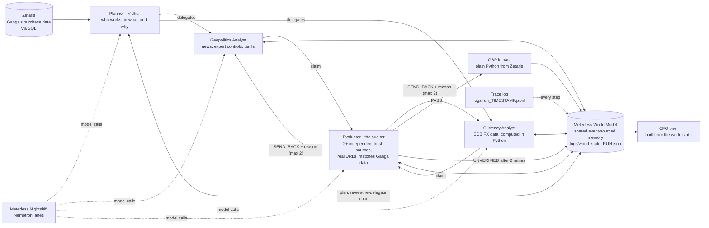

# Vidhur

**The Agent That Can Explain Why** - an entry for the Open Agent Hackathon 2026 (GenAI Works), Track 2.

Vidhur is a multi-agent cost-risk agent for a **fictional** company, **Ganga AI Solutions** (a UK maker of GPU / AI servers).
It reads Ganga's purchase history, decides which risks matter, sends specialist analysts to check them against real news and
real exchange rates, has an independent auditor verify every claim, and tells the CFO how much a risk could cost in GBP -
as a range (worst / likely / best) with a confidence level and the evidence behind it.

The point of the track: **every recommendation carries evidence.** The Evaluator (the auditor) checks each claim before it can
reach the CFO brief; claims it cannot verify are sent back, and if they still fail they are marked **UNVERIFIED** and get no number.

## Architecture



What happens in a run (`python main.py`):

1. **Zetaris health check**, then Ganga's spend by part and supplier country (SQL on Zetaris, not the CSV files).
2. **Planner (Vidhur)** reads that spend plus a quick headline scan and decides *which analysts run for which parts and why* (a real
   model call; the plan is validated in Python and may skip analyst/part pairs, e.g. no FX data exists for the Taiwan dollar).
3. **Analysts run in parallel** (3 workers). The Geopolitics Analyst turns the 8 most relevant news articles into a claim; the
   Currency Analyst computes the real 30/90-day move of the supplier's currency against the pound from ECB data in Python and the model only explains it.
4. **Evaluator** reads each claim from the world state: deterministic checks first (2+ sources, different publishers, fresh, every URL really
   fetched, part and country exist in Zetaris, FX numbers match the computed ones), then a Nemotron "do the sources support the claim?" check.
   Then the trust rules: at least one fresh Tier 1 or Tier 2 source, copies of one report count once, stale sources do not count.
   `SEND_BACK` returns the claim to the analyst with the reason (max 2 retries), then `UNVERIFIED`.
5. **Planner reviews** the world state and may **re-delegate once** (e.g. ask the other analyst about a high-spend part that ended unverified).
6. **GBP impact** is plain Python from Zetaris data (latest-quarter spend x % range); confidence comes from the Evaluator result.
7. **CFO brief** (`output_examples/brief_<timestamp>.md`) is built from the world state: plan and reasons, verified claims with worst/likely/best GBP,
   UNVERIFIED items, evidence trail, and pointers to the trace and the world-state file.

## Meterless World Model engine

The shared memory is the **Meterless World Model**, implemented from the official spec (`engines/world-model/AGENTS.md`) in
`engines/world_model/` (Python): event-sourced append-only log, content-derived stable ids, provenance on every write, bitemporal edges,
idempotent ingest, audit log. It passes the 8 conformance checks and reproduces the Meterless TypeScript reference byte for byte on golden
data. Full details, what we followed and where we deliberately differ: [`docs/meterless_engine.md`](docs/meterless_engine.md).

## Ganga's data is synthetic

Everything in `data/` (parts, suppliers, quarterly prices and quantities) is **made up** and pre-prepared for the hackathon.
Ganga AI Solutions does not exist. See `data/README_DATA.md`. The **evidence is real**: news from free RSS feeds (Google News search
plus BBC, The Guardian, Al Jazeera, NPR, DW) and exchange rates from the free ECB-based Frankfurter API.

## How to run it

Prerequisites: Docker Desktop with the Zetaris platform running (UI http://localhost:3000, API http://localhost:8888),
and the Meterless Nightshift app running (http://127.0.0.1:8088/v1) with two lanes: `vidhur-analyst` and `vidhur-evaluator`.

```powershell
python -m venv venv                  # first time only
venv\Scripts\activate
pip install -r requirements.txt
copy .env.example .env               # then fill in the token / Zetaris login (never commit .env)

python scripts/load_ganga_to_zetaris.py   # copies data/*.csv into Zetaris and registers tables; safe to run twice
python main.py                            # the full run
python main.py --demo-weak-claim          # watch the Evaluator catch a weak claim (below)
python main.py --demo-untrusted-source    # watch it catch a claim backed only by untrusted sources (below)
python scripts/check_lanes.py             # which Nemotron model answers each Nightshift lane (3 calls per lane)
python -m pytest tests                    # unit + engine tests; integration tests skip if Zetaris/Nightshift are down
```

Options: `--workers N` (parallel analysts, default 3), `--refresh-news` (ignore the news cache). Env: `PLANNER_MAX_DELEGATIONS`
(default 4), `LLM_MAX_ATTEMPTS` (default 5), `EVIDENCE_MAX_AGE_DAYS` (default 30).

### `--demo-weak-claim` (a demo flag, not hidden faking)

With this flag the **Geopolitics Analyst's first attempt** gets one extra instruction: cite exactly one source. The model call is real and
the Evaluator's check is real; only the analyst's instruction changes. The Evaluator then sends the claim back (`TOO_FEW_SOURCES`), the analyst
revises it with the feedback, and the brief shows the full audit history. The flag is printed in the console, recorded in the trace
(`demo_weak_claim: true`) and stated at the top of the brief. (The Currency Analyst always cites the FX data plus news, so the flag does not affect it.)

### `--demo-untrusted-source` (a demo flag, not hidden faking)

With this flag the **Geopolitics Analyst's first attempt** is shown the *least-trusted* articles first (Tier 3 before Tier 1) and is told to
cite only the first two. The model call and the Evaluator's check are real; only the evidence offered to the analyst and the instruction change.
The Evaluator sends the claim back (`NO_TRUSTED_SOURCE`, and `SOURCES_NOT_INDEPENDENT` if the two share a publisher), the analyst revises
from the normal trust-ranked evidence, and the claim passes on retry or ends `UNVERIFIED`. The flag is printed, recorded in the trace
(`demo_untrusted_source: true`) and stated at the top of the brief.

## Trusted-source ranking


Not every source is equal, so Vidhur ranks evidence by who published it, not only by how relevant it is.

- **The list** is `data/source_trust.csv` (`domain,publisher,tier,score`), a curated, editable config (see `data/SOURCE_TRUST_README.md`).
  Tier 1 = 1.0 (wires, top business press, central banks, statistics offices, WTO / IMF / World Bank, semiconductor trade bodies),
  Tier 2 = 0.7 (known business and trade press), Tier 3 = 0.3 (any unlisted domain, the default).
- **Mapping** (`core/source_trust.py`): URL -> (publisher, tier, score). Subdomains count as their parent (`uk.reuters.com` is `reuters.com`).
  Google News links point at `news.google.com`, so for those the publisher name decides.
- **Ranking before the AI sees anything:** `combined_score = 0.6 * relevance + 0.4 * trust_score`, relevance being the existing keyword and recency
  score normalised to 0-1. Only the top N (unchanged) go to the model, which cuts tokens. Kept and dropped articles are logged to the trace
  with their scores (`evidence:rank`).
- **Evaluator rules** (added to the existing checks, new send-back codes): `NO_TRUSTED_SOURCE` (no fresh Tier 1 or 2 source),
  `SOURCES_NOT_INDEPENDENT` (same domain root or near-identical headlines count once), `STALE_SOURCES` (sources older than `EVIDENCE_MAX_AGE_DAYS`,
  default 30, do not count), next to `TOO_FEW_SOURCES`. Max 2 retries, then UNVERIFIED, as before.
- **CFO brief:** every source shows publisher, tier and date, and each claim has an evidence-strength line such as
  "2 independent sources, 1 Tier 1".

## Where things are

| Path | What |
|---|---|
| `agents/planner.py` | Planner (Vidhur): plan, delegations with reasons, review and one re-delegation |
| `agents/geopolitics_analyst.py`, `agents/currency_analyst.py` | The two analysts |
| `agents/evaluator.py` | The Evaluator and the send-back loop |
| `agents/workflow.py` | One work item: analyst -> Evaluator loop -> GBP impact |
| `engines/world_model/` | Meterless World Model engine |
| `core/shared_state.py` | Vidhur's use of the world model (what each agent writes and reads) |
| `core/zetaris_client.py` | Zetaris REST client - one Lightning SQL statement per request |
| `core/llm.py` | Meterless Nightshift client (OpenAI-compatible), retries, pin tracking |
| `core/trace.py` | Append-only JSONL trace (agent, target, model, tokens, latency, sources, decision) |
| `core/news.py`, `core/fx.py` | Real evidence: RSS news and ECB exchange rates; trust-aware ranking |
| `core/source_trust.py`, `data/source_trust.csv` | Publisher trust tiers (curated list) |
| `scripts/check_lanes.py` | Calls each Nightshift lane 3 times and prints which model answered |
| `core/impact.py`, `core/brief.py` | GBP maths and confidence; the CFO brief |
| `scripts/load_ganga_to_zetaris.py` | Registers Ganga's CSVs as Zetaris tables |
| `docs/meterless_engine.md` | The World Model spec we followed and the test results |

## Notes on the AI runtime

All product AI calls go through Meterless Nightshift, and every AI call is Nvidia Nemotron. **All agents (Planner, both analysts, Evaluator) use the
lane `vidhur-analyst`** (`nvidia/nemotron-3.5-lightning-30b-a3b`); see Known limitations for why. `.env` holds the lane to request (`MODEL_*`) and the
Nemotron model that must answer (`MODEL_*_EXPECTED`). **Every AI call line in the trace records `requested_lane`, `answered_model` and `pin_honoured`**
(failed attempts record `answered_model: null`). `python scripts/check_lanes.py` re-tests the lanes. The runtime enforces a ~45 s per-request deadline
and answers 502 when a long reasoning call overruns it, so the client retries automatically (`LLM_MAX_ATTEMPTS`) and logs every failed attempt.

## Known limitations

- **Two analysts of six.** Commodity, logistics, trade & tariff and supplier-health analysts are not built. There is no Red Team and no Docker packaging.
- **The evaluator lane could not be pinned to a larger Nemotron in Nightshift**, so Lightning (`nemotron-3.5-lightning-30b-a3b`) is used for all
  agents. `scripts/check_lanes.py` showed `vidhur-evaluator` answered by Lightning in 3 of 3 calls, so the Planner and Evaluator are pointed at the
  `vidhur-analyst` lane on purpose (the pin is real, not accidental). If a larger lane is fixed, set `MODEL_EVALUATOR` / `MODEL_EVALUATOR_EXPECTED` in `.env`.
- **Currency pass-through is assumed 100%** (an upper bound): the claim treats the supplier currency's move against the pound as the cost move.
  Ganga's data is USD-priced, so real exposure may be smaller. The Taiwan dollar is not published by the ECB, so Taiwan gets no FX claim.
- **Geopolitics evidence is mostly headlines.** Google News RSS gives titles and publishers, not article text. The % ranges are the model's own
  estimates, not source figures; the GBP maths on top is exact.
- **The trust list is a hand-curated config**, not a measure of accuracy: it ranks who published, not whether a given story is right. Unlisted
  publishers are Tier 3 by default, and a Google News link is classified by its publisher name, not by fetching the article.
- **Baseline is one quarter** (the latest in the data); no seasonality, hedging or contract terms.
- **Runs are slow and flaky** because of the runtime's per-request deadline and provider errors; a work item whose model calls keep failing is
  reported as "not assessed" rather than guessed.
- **World Model:** the Python engine implements the spec's core (not the browser control plane, H-MEM sync or embedding-based merging).
- Synthetic data only; nothing here is financial advice.
